<div align="center">

# Lyftr Chat: LLM Chatbot with Key Failover and Response Caching

[](https://github.com/anish295/LLM-ChatBot-Lyftr-AI/actions/workflows/ci.yml)
[](LICENSE)


</div>

A full-stack AI chat app: **React (Vite)** frontend and **FastAPI** backend, with a **LiteLLM** gateway and **SQLite** storage.
The backend holds a pool of API keys and **fails over automatically** when a key returns 429, a quota error, a 5xx, a timeout or an auth error.
Repeated conversations are answered from **LiteLLM's built-in cache** and labelled `LLM_CACHE`; live answers are labelled `LIVE_INFERENCE`.
Each reply shows **that request's** model, latency and input/output tokens.
Conversations are stored per session in SQLite on a Docker volume, so they survive restarts.

> **Why this design:**
> - A small, explicit failover loop around `litellm.acompletion` (one call per key, `num_retries=0`) makes every attempt observable. That gives exact `key_id` and `fallback_attempts` values, lets the `X-Simulate-Failure` hook inject failures into the *real* code path, and means a dead key can never crash a request.
> - LiteLLM's own cache keys on model + full message list, so identical conversations share answers and anything different never does.
> - SQLite (WAL, one transaction per successful turn) is all the state the app needs.

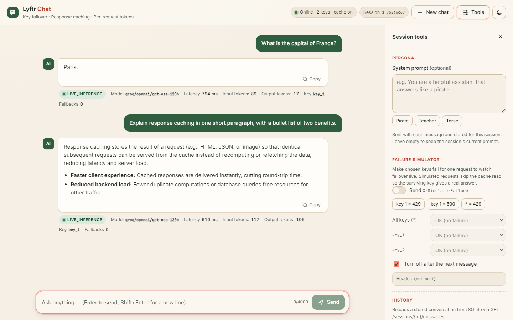

---

## Table of contents

- [Features](#features)
- [1. Live URLs](#1-live-urls)
- [2. Run locally: with Docker and without](#2-run-locally-with-docker-and-without)
- [3. Design decisions: key fallback, caching, SQLite session storage](#3-design-decisions-key-fallback-caching-sqlite-session-storage)
- [4. Verification: how to see failover, cache hits and per-message token usage](#4-verification-how-to-see-failover-cache-hits-and-per-message-token-usage)
- [5. Setup Used: editor and AI tools](#5-setup-used-editor-and-ai-tools)
- [6. Bonus features: what was added beyond the requirements and why](#6-bonus-features-what-was-added-beyond-the-requirements-and-why)
- [Screenshots](#screenshots)
- [API reference](#api-reference)
- [Environment variables](#environment-variables)
- [Tests](#tests)
- [Deployment (free tier, step by step)](#deployment-free-tier-step-by-step)
- [Folder structure](#folder-structure)
- [Troubleshooting](#troubleshooting)
- [Limitations and future work](#limitations-and-future-work)

## Features

| Area | What you get |
|---|---|
| **Contract** | Exactly three endpoints: `GET /health`, `POST /chat`, `GET /sessions/{id}/messages`. Field names and types match the spec, and every error is JSON with `detail`. |
| **Resilience** | Ordered key pool (`key_1`, `key_2`, ...) with automatic failover on 429/quota/5xx/timeouts/connection/auth errors and empty replies. All keys failing returns a clean `503 {"detail":"all providers unavailable"}`. A key cooldown (circuit breaker) skips keys that were just rate-limited. |
| **Caching** | LiteLLM `Cache(type="disk")` on the `/data` volume, keyed on model + full message list. Hits return the identical reply and the stored token usage, with `key_id: null`. The disk cache persists across restarts. |
| **Tokens and latency** | `input_tokens` / `output_tokens` for *this* request only, plus a server-measured integer `latency_ms`. |
| **Multi-turn** | History rebuilt from SQLite every turn (`system + history + new message`); per-session locks keep concurrent turns ordered. Optional per-session system prompt. |
| **Failover test hook** | `X-Simulate-Failure: key_1=429`, `key_1=429,key_2=500` or `*=429`, honoured only when `ENABLE_FAILURE_SIMULATION=true`. Applies to that one request only. |
| **UI** | Polished React chat with all required `data-testid`s, per-reply metadata badges, a system prompt field, a failure simulator, Markdown and code highlighting, retry, export, session restore, light and dark themes, mobile layout and accessibility. |
| **Ops** | Multi-stage Docker images (non-root, healthchecks), `make up`, structured JSON logs with request ids, rate limiting, GitHub Actions CI, a keep-alive cron and a Render blueprint. |

---

## 1. Live URLs

Every URL below is public and needs no login.

| What | URL |
|---|---|
| **Frontend** (Netlify) | **https://lyftr-llm-chatbot.netlify.app** |
| **Backend** (Render, free Docker web service) | **https://lyftr-chat-backend.onrender.com** |
| Swagger UI | https://lyftr-chat-backend.onrender.com/docs |
| Health | https://lyftr-chat-backend.onrender.com/health |
| Repository | https://github.com/anish295/LLM-ChatBot-Lyftr-AI |

The live deployment passes all 52 smoke-test checks (`bash scripts/smoke_test.sh https://lyftr-chat-backend.onrender.com`) and the 5 Playwright UI contract tests against the Netlify URL.

> The backend runs on Render's free tier and **sleeps after about 15 minutes idle**, so the first request can take 30-60 s. The UI shows a "warming up the server…" state and retries once. See [keep-alive](#6-keep-the-free-backend-awake).

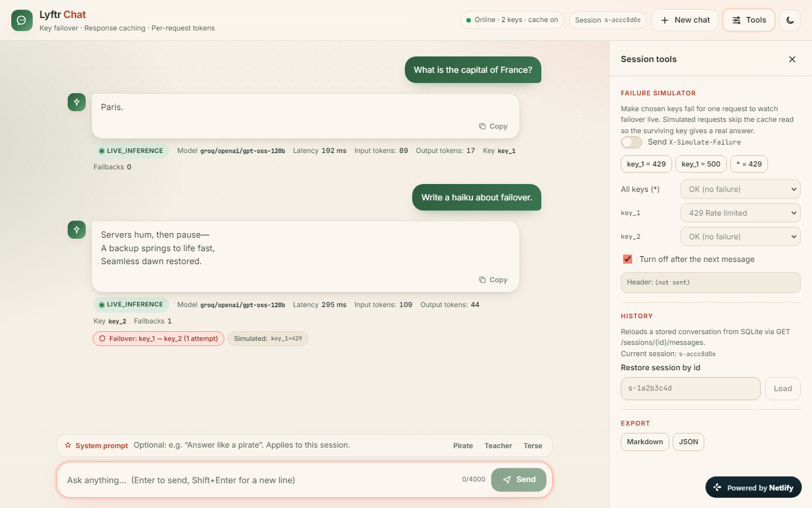

---

## 2. Run locally: with Docker and without

### Prerequisites
- **Docker** with the Compose plugin (Docker Desktop on Windows/macOS), and `make` (on Windows use `mingw32-make`, or run the `docker compose` commands directly).
- **Two or more API keys** from the same provider. The default is Groq: create keys at **https://console.groq.com/keys**, using two accounts or projects to get separate quotas. For Gemini, create keys at **https://aistudio.google.com/apikey**.

### With Docker (recommended)

```bash
git clone https://github.com/anish295/LLM-ChatBot-Lyftr-AI.git
cd LLM-ChatBot-Lyftr-AI
cp .env.example .env            # then put your real keys in LLM_API_KEYS=key1,key2
make up                         # builds both images and starts the stack
```

- Frontend: **http://localhost:3000**
- Backend: **http://localhost:8000** (Swagger at http://localhost:8000/docs)

Other useful targets:

```bash
make logs        # follow logs
make down        # stop (the data volume is kept, so history survives)
make up          # start again: previous sessions are still there
make smoke       # run the end-to-end contract check against http://localhost:8000
make test        # backend unit tests (local Python)  |  make test-docker (no local Python)
make clean       # stop AND delete the volume (wipes history + cache)
```

> `make up` creates `.env` from `.env.example` if it is missing. If port 3000 or 8000 is already taken on your machine, set `FRONTEND_PORT` / `BACKEND_PORT` in `.env`. Add the new frontend origin to `ALLOWED_ORIGINS` if you change it.

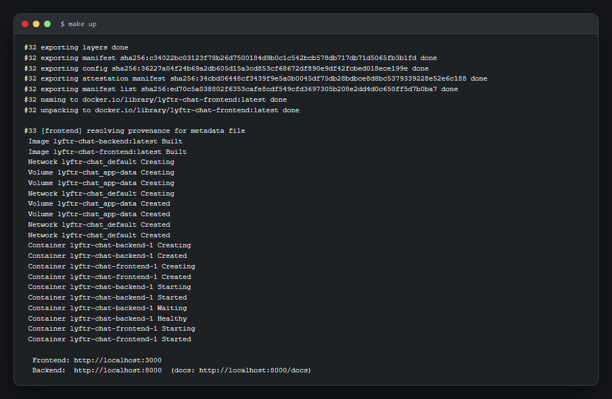

### Without Docker

**Backend** (Python 3.11+):

```bash
cd backend
python -m venv .venv && source .venv/bin/activate      # Windows: .venv\Scripts\activate
pip install -r requirements-dev.txt
export LLM_API_KEYS="key1,key2"                         # PowerShell: $env:LLM_API_KEYS="key1,key2"
export ENABLE_FAILURE_SIMULATION=true
export DATABASE_URL="sqlite:///./data/app.db" CACHE_DIR="./data/llm_cache"
uvicorn app.main:app --reload --port 8000
```

**Frontend** (Node 20+):

```bash
cd frontend
npm install
echo "VITE_API_BASE_URL=http://localhost:8000" > .env.local
npm run dev            # http://localhost:5173 (already in the default ALLOWED_ORIGINS)
```

---

## 3. Design decisions: key fallback, caching, SQLite session storage

### Architecture

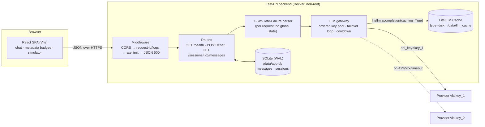

### Request flow: cache hit, failover and all-keys-down

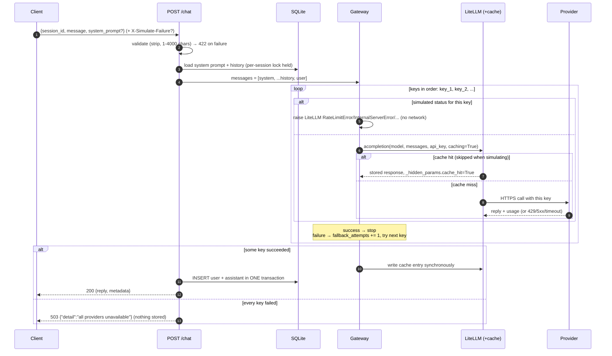

### Key fallback

- **Pool:** `LLM_API_KEYS` is split on commas (whitespace trimmed, empties ignored) into `key_1..key_N`. Raw keys never appear in a response or a log. Every log line uses key ids, and exception text is passed through a redactor before logging (Gemini, for example, can put the key in a URL).
- **Loop, not Router:** for each key, in order starting at `key_1` (deterministic), we call `litellm.acompletion(model, messages, api_key=..., caching=True, num_retries=0, timeout=...)`. LiteLLM normalises provider errors into typed exceptions. **Any** failure on a key fails over: `RateLimitError`/quota (429), `InternalServerError`/`ServiceUnavailableError`/`APIError` (5xx), `Timeout`, `APIConnectionError`, auth errors (401/403, so a dead key never breaks the app) and empty replies. The loop is bounded by the pool size, so it can never spin. When every key fails, we raise a domain error that maps to `503 {"detail":"all providers unavailable"}`.
  *Why not LiteLLM's `Router` fallbacks?* There are three concrete reasons:
  1. **Per-request simulation:** the Router's cooldown is shared process state. A simulated `key_1=429` would bench `key_1` for later requests too, which breaks "for this request only".
  2. **Deterministic key ids:** the Router's load balancing picks deployments itself, so `key_id` and `fallback_attempts` would not be deterministic.
  3. **Exact attempt count:** the contract needs the number of keys that failed *before* the answering one, which the Router does not expose.

  So LiteLLM does all the provider work (`litellm.acompletion` for every call, the typed `litellm.*Error` exceptions that drive failover, and the built-in `litellm.cache`), while the ordering and accounting stay in ~40 lines we control and test.
- **Cooldown (circuit breaker):** after a *real* 429/401/403, a key is skipped for `KEY_COOLDOWN_SECONDS` (default 30). A skipped key counts as a failed attempt. If every key is cooling down, they are still tried as a last resort. Simulated requests neither read nor write cooldown state, so the hook's contract table always holds.

### Caching

- **LiteLLM's built-in cache:** `litellm.cache = Cache(type="disk", disk_cache_dir=CACHE_DIR)` on the `/data` volume (`CACHE_TYPE=local` switches to in-memory). Every call passes `caching=True`.
- **Cache key = model + full message list** (system prompt + history + new message), plus fixed sampling params. LiteLLM hashes exactly those call parameters. **`api_key` is not part of the key**, which [`tests/test_cache.py`](backend/tests/test_cache.py) proves, so an answer produced by `key_2` is served to any identical later request. Consequences:
  - The same first message in a new session is a hit. The system prompt is identical by default, which is also why equal-length first messages report the same `input_tokens`.
  - A different message, or the same message with different history, is never a hit.
- **Hit detection** uses `response._hidden_params["cache_hit"]`. On a hit the reply text is identical, the tokens are the usage stored with the cached response, `key_id` is `null` and `fallback_attempts` is `0`.
- **No race on back-to-back requests:** LiteLLM normally writes the cache from a background logging task a few milliseconds *after* returning. The gateway writes the entry synchronously through `litellm.cache.async_add_cache` (same key derivation) before responding, so an identical request fired immediately afterwards is guaranteed to hit. LiteLLM's later write is an idempotent overwrite.
- **Temperature 0** by default, so live answers are stable and cache-friendly.
- **Simulated requests bypass the cache *read*** (`cache={"no-cache": True}`). Otherwise a previously cached message would come back as `LLM_CACHE` and hide the failover. The surviving key therefore produces a **real, live answer**, never an error wrapped in a 200. Its answer is still written to the cache.
- **Version pin:** `litellm==1.77.7`. Newer releases removed the `disk` cache type, and their cache-hit path imports proxy-only dependencies. 1.77.7 is the newest release I verified with the native disk cache.

### Token accounting

`input_tokens` and `output_tokens` come straight from the provider's `usage` block (`prompt_tokens` / `completion_tokens`) for this request. The prompt count covers system + history + new message, and is never summed across turns. The default model (`gpt-oss-120b`) is a reasoning model, so `output_tokens` also includes the hidden reasoning tokens the provider bills for. That's why a one-word answer can report ~15-30 output tokens. On a cache hit the usage stored with the cached response is returned unchanged. If a provider ever omits usage, `litellm.token_counter` is used as a fallback.

### SQLite session storage

- `DATABASE_URL` (e.g. `sqlite:////data/app.db`) sets where the file lives on the Docker named volume. Parent directories are created and the schema is applied **on every startup** (`CREATE TABLE IF NOT EXISTS`).
- Tables: `messages` (exactly the spec's columns, plus an index on `(session_id, id)`) and `sessions` (`session_id`, `system_prompt`, timestamps). The system prompt is stored per session, reused on later turns that omit it, and **never** returned by the history endpoint.
- **Atomic turns:** the user message and the assistant reply are inserted **together in one transaction, only after success**. A 422 or 503 leaves history untouched, and a brand-new session that fails is not created (its history returns 404).
- **Concurrency:** WAL mode, a busy timeout, `aiosqlite` (the event loop is never blocked), parameterised queries only, and a per-session `asyncio.Lock` so concurrent turns on one session stay ordered while different sessions run in parallel.
- **Latency** is measured with `time.perf_counter()` from just after validation to just before persisting, so it covers the history load, every LLM attempt and the cache. A cache hit typically takes 1-10 ms against 400-1500 ms live.

### Trade-offs

| Decision | Trade-off |
|---|---|
| Lenient `X-Simulate-Failure` parsing (malformed pairs, unknown statuses or unknown keys are ignored and logged) | A typo doesn't 422 the request; it is visible in the logs and the UI shows the header that was sent. |
| Free Render plan without a disk | `/data` is ephemeral there: SQLite and the cache reset on redeploy. Locally the named volume persists. |
| Full history sent every turn | Exact context and correct cache keys, but very long chats grow the prompt. See [future work](#limitations-and-future-work). |
| In-process rate limiter and cooldown | Zero infrastructure (no Redis, per the brief). State is per process and resets on restart. |

---

## 4. Verification: how to see failover, cache hits and per-message token usage

Set the base URL once (local or deployed):

```bash
B=http://localhost:8000          # or https://<your-backend>.onrender.com
```

### Run everything at once

```bash
make smoke                                   # local
bash scripts/smoke_test.sh "$B"              # any URL: 52 contract checks, exits non-zero on failure
```

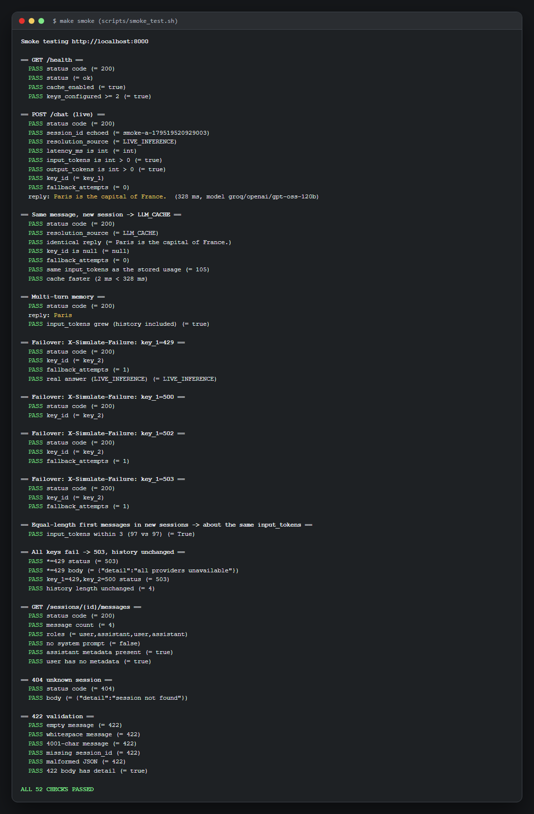

### Health

```bash
curl -s $B/health
# {"status":"ok","keys_configured":2,"cache_enabled":true}
```

### Cache hits (`LIVE_INFERENCE` then `LLM_CACHE`)

```bash
curl -s -X POST $B/chat -H 'Content-Type: application/json' \
  -d '{"session_id":"demo-1","message":"What is the capital of France?"}'
# ... "resolution_source":"LIVE_INFERENCE","latency_ms":473,"input_tokens":89,"output_tokens":17,"key_id":"key_1","fallback_attempts":0

curl -s -X POST $B/chat -H 'Content-Type: application/json' \
  -d '{"session_id":"demo-2","message":"What is the capital of France?"}'
# ... same "reply", "resolution_source":"LLM_CACHE","latency_ms":2, same tokens, "key_id":null,"fallback_attempts":0
```

**UI:** send a message, then click **New chat** (or reload the page) and send the same message. The second reply carries a coral/red **LLM_CACHE** badge, and a chip shows how much faster it was than the live call.

### Failover with `X-Simulate-Failure`

```bash
curl -s -X POST $B/chat -H 'Content-Type: application/json' -H 'X-Simulate-Failure: key_1=429' \
  -d '{"session_id":"demo-3","message":"Name one planet."}'
# 200 ... "resolution_source":"LIVE_INFERENCE","key_id":"key_2","fallback_attempts":1

curl -s -X POST $B/chat -H 'Content-Type: application/json' -H 'X-Simulate-Failure: key_1=500' \
  -d '{"session_id":"demo-3","message":"Name another planet."}'
# 200 ... "key_id":"key_2"

curl -s -i -X POST $B/chat -H 'Content-Type: application/json' -H 'X-Simulate-Failure: *=429' \
  -d '{"session_id":"demo-3","message":"This fails"}'
# HTTP/1.1 503 ... {"detail":"all providers unavailable"}   (and nothing is added to demo-3's history)
```

**UI:** open **Tools → Failure simulator** and click **key_1 = 429**, then send a message. The reply shows `Key key_2`, `Fallbacks 1` and a **Failover: key_1 → key_2 (1 attempt)** chip. Click **\* = 429** and send again: a readable *"All AI providers are currently unavailable"* card appears with a Retry button.

### Per-message token usage and multi-turn memory

```bash
curl -s -X POST $B/chat -H 'Content-Type: application/json' \
  -d '{"session_id":"demo-4","message":"My name is Ada. Just say hi."}'
curl -s -X POST $B/chat -H 'Content-Type: application/json' \
  -d '{"session_id":"demo-4","message":"What is my name?"}'
# reply mentions Ada; input_tokens grows (history is part of the prompt) but is never a running total;
# output_tokens is only this reply

curl -s $B/sessions/demo-4/messages        # oldest first, no system prompt, metadata on assistant turns
curl -s -i $B/sessions/nope/messages       # 404 {"detail":"session not found"}
```

**UI:** every assistant reply shows `Input tokens:` and `Output tokens:` for that request only. There are no conversation totals anywhere.

### Validation (422, always JSON)

```bash
curl -s -X POST $B/chat -H 'Content-Type: application/json' -d '{"session_id":"x","message":"   "}'   # whitespace
curl -s -X POST $B/chat -H 'Content-Type: application/json' -d '{"message":"hi"}'                   # missing session_id
curl -s -X POST $B/chat -H 'Content-Type: application/json' -d '{"session_id":"x","message":'      # malformed JSON
```

---

## 5. Setup Used: editor and AI tools

| | |
|---|---|
| **Editor** | Visual Studio Code (with the Claude Code extension) |
| **AI tools** | **Claude Code** (Anthropic): architecture, implementation, tests, Docker, docs. Every behaviour was verified by running the test suite, the smoke test and Playwright against the real stack. |
| **Model provider during development** | Groq free tier (`groq/openai/gpt-oss-120b`) with two keys |
| **Other tooling** | Docker Desktop, Playwright (UI contract tests + screenshots), ruff, pytest, GitHub Actions |

---

## 6. Bonus features: what was added beyond the requirements and why

| Feature | Why |
|---|---|
| **Failure Simulator panel** (presets `key_1=429`, `key_1=500`, `*=429`, per-key dropdowns, a one-shot toggle and a live header preview) plus a **Failover chip** on affected replies | Demonstrates failover live in the UI without curl. It detects whether the backend has simulation enabled from an `X-Failure-Simulation` header on `/health`, leaving the response body untouched, and disables itself with an explanation if not. |
| **`key_id` + `fallback_attempts` in the metadata row** (`meta-key`, `meta-fallbacks`) | Makes resilience visible on every reply, not just in logs. |
| **Cache performance chip**, e.g. "Cache hit: 397× faster than live" | Shows the speed benefit of caching using latencies of the same prompt, never token totals. |
| **Markdown rendering** with syntax highlighting (theme-aware) and a **copy button** per reply | LLMs answer in Markdown. Raw HTML is never rendered (react-markdown escapes it), so model output cannot inject markup. |
| **Retry button** on error cards | Recovers from a transient 503 or network error without retyping. |
| **New chat**, **Restore session by id** (uses `GET /sessions/{id}/messages`), **Export** to Markdown/JSON | Exercises the history endpoint visually and makes conversations portable. A new session still starts on every page load, as required. |
| **Light and dark themes**: Beige + Forest Green + Coral, and Charcoal + Moonlit Silver + Signal Red. Follows `prefers-color-scheme` and persists the toggle | A polished look with WCAG-AA contrast. The red primary button is darkened (#CC2A25) so white text passes AA. |
| **Backend status pill**, a **"warming up the server…" state** and one automatic retry on network errors | Free-tier cold starts otherwise look like a broken app. |
| **Key cooldown / circuit breaker** (`KEY_COOLDOWN_SECONDS`) | Avoids hammering a key that has just been rate-limited. Disabled for simulated requests so the contract table always holds. |
| **Per-IP rate limit** on `POST /chat` (default 120/min, JSON 429), **X-Request-ID**, **structured JSON logs**, **graceful shutdown** | Protects free-tier LLM quotas, keeps logs traceable, and lets the server drain in-flight requests on SIGTERM. |
| **Playwright UI contract tests** plus **GitHub Actions** (pytest, ruff, frontend build, docker build) and a **keep-alive workflow** | Regression safety for the exact contract, and a warm backend on the free tier. |
| **Accessibility**: `aria-live` announcements, keyboard-only flow (Enter sends, Shift+Enter adds a newline), visible focus rings, reduced-motion support | A usable experience for everyone. |

---

## Screenshots

| | |
|---|---|
| **Light theme**<br> | **Dark theme** (code highlighting)<br>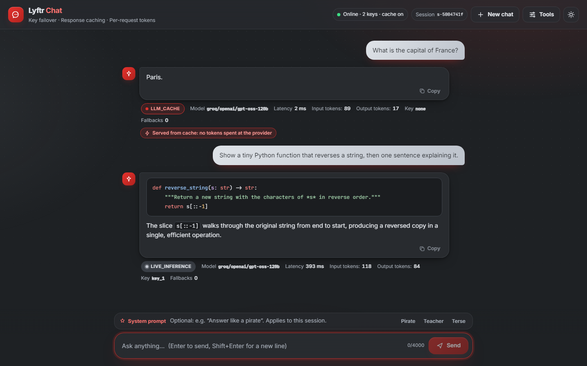 |
| **LIVE_INFERENCE reply with metadata**<br>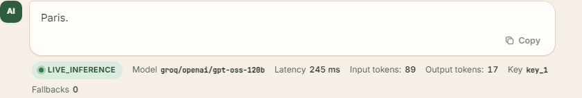 | **LLM_CACHE reply** (identical text, 2 ms, key none)<br>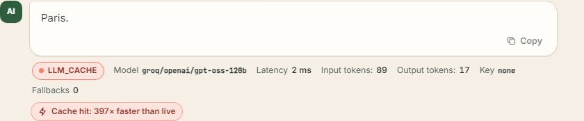 |
| **Failover key_1 → key_2** via the simulator<br>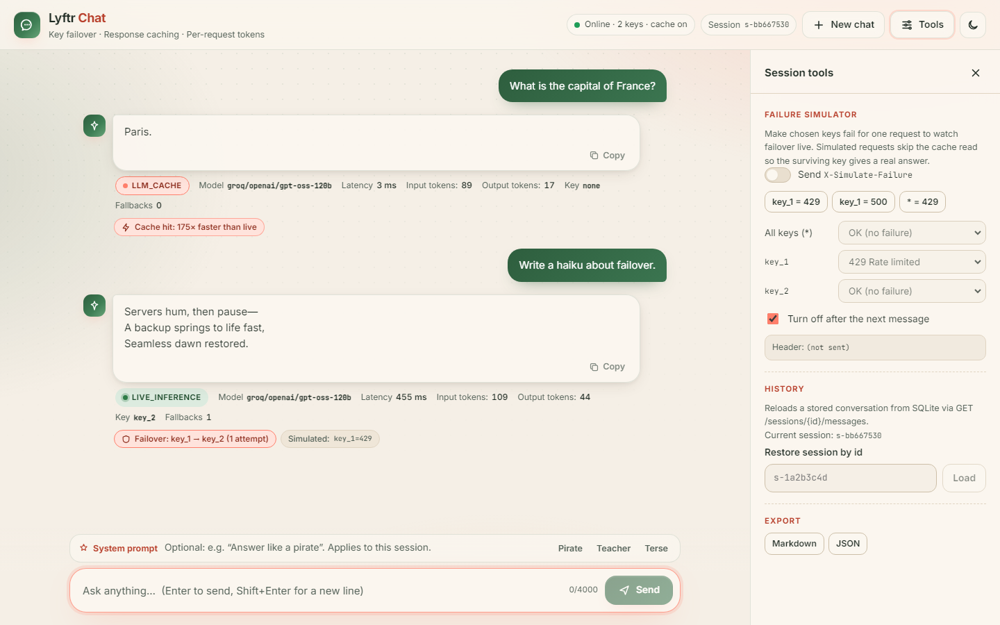 | **Clean 503** when every key fails<br>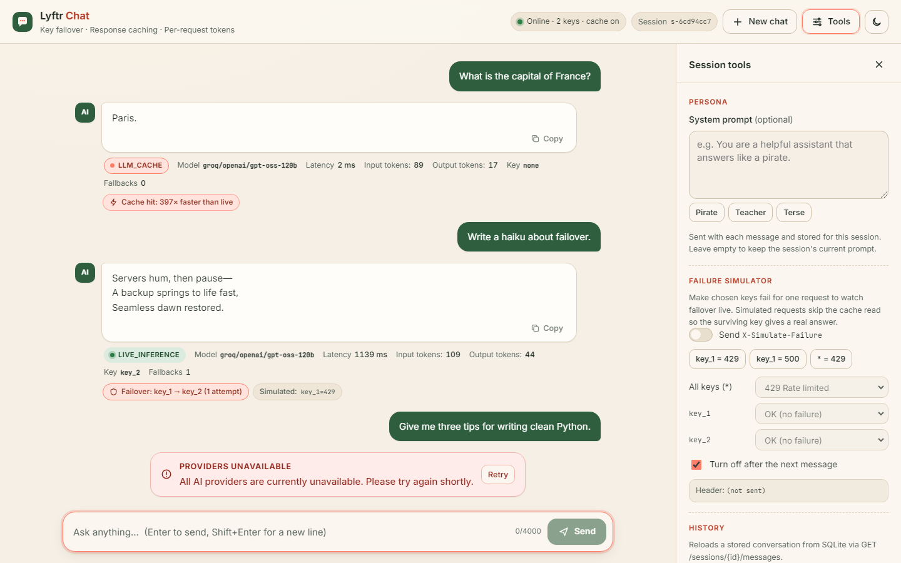 |
| **System prompt** field (pirate persona)<br>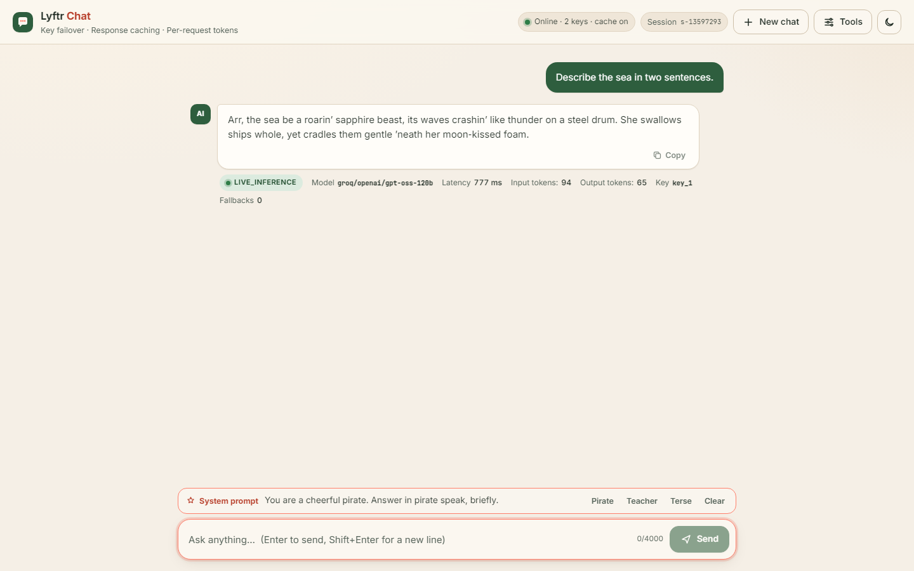 | **Swagger** `/docs`<br>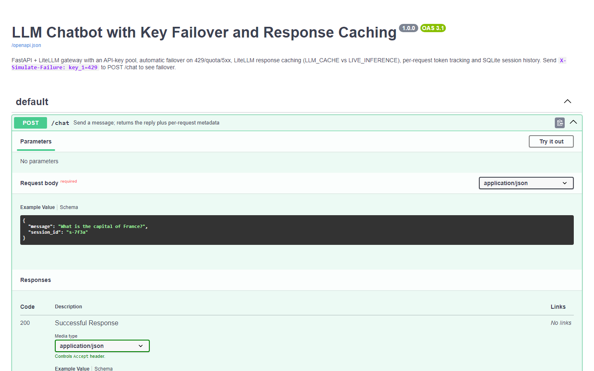 |
| **Mobile (light)**<br>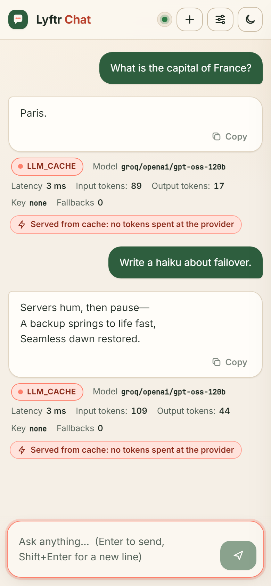 | **Mobile (dark)**<br>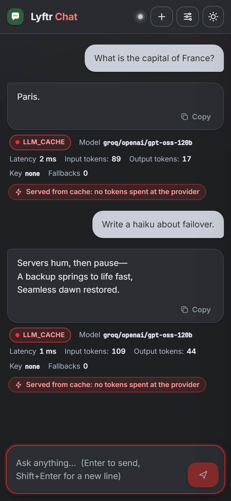 |
| **Empty state**<br>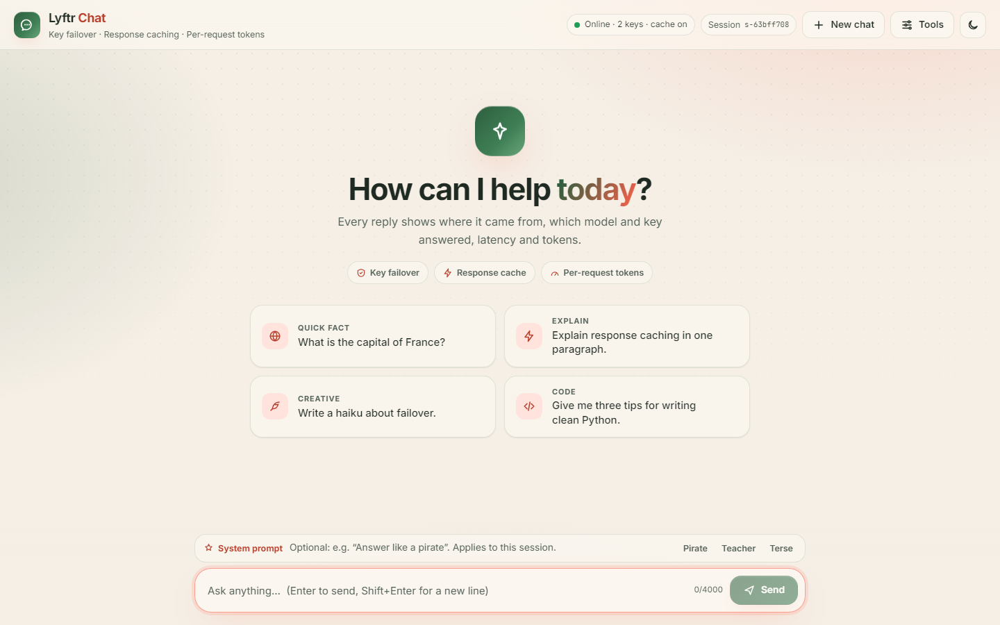 | **pytest**<br>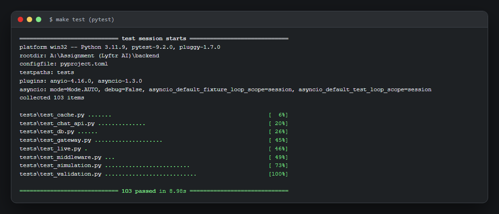 |

> Screenshots were captured with Playwright (`frontend/e2e/screenshots.spec.ts`) against the local Docker stack using real Groq keys. To refresh them, run `make clean && make up`, then `cd frontend && npx playwright test e2e/screenshots.spec.ts`.
> `docs/screenshots/14-deployed-app.png` was captured from the live Netlify deployment.

---

## API reference

Base URL: `http://localhost:8000` locally. Interactive docs are at `/docs`. All bodies are JSON, and **all errors are `{"detail": ...}`**.

### `GET /health`
`200 {"status":"ok","keys_configured":2,"cache_enabled":true}` when the app is up, `SELECT 1` succeeds on SQLite and the key pool is loaded. Otherwise it returns `503 {"detail": "...", ...}`. The response header `X-Failure-Simulation: enabled|disabled` is informational and used by the UI.

### `POST /chat`

| Field | Type | Rule |
|---|---|---|
| `session_id` | string | required, 1-128 chars, client-generated. An unknown id starts a session. |
| `message` | string | required, 1-4000 chars **after trimming** (the trimmed text is what is used) |
| `system_prompt` | string | optional, up to 4000 chars. Overrides the default for this session and is stored for later turns. |

Optional header: `X-Simulate-Failure: key_1=429 | key_1=429,key_2=500 | *=429` (statuses 429/500/502/503; honoured only when `ENABLE_FAILURE_SIMULATION=true`).

```json
{
  "session_id": "s-7f3a",
  "reply": "Paris is the capital of France.",
  "metadata": {
    "resolution_source": "LIVE_INFERENCE",
    "model": "groq/openai/gpt-oss-120b",
    "latency_ms": 473,
    "input_tokens": 105,
    "output_tokens": 30,
    "key_id": "key_1",
    "fallback_attempts": 0
  }
}
```

| Status | When | Body |
|---|---|---|
| 422 | missing/empty/whitespace message or session_id, message > 4000 chars, wrong types, malformed JSON | `{"detail":[{"type":...,"loc":[...],"msg":...}]}` |
| 429 | rate limit exceeded (bonus, generous) | `{"detail":"rate limit exceeded"}` |
| 503 | every key failed | `{"detail":"all providers unavailable"}` |
| 500 | unexpected bug (trace logged server-side only) | `{"detail":"internal server error"}` |

### `GET /sessions/{session_id}/messages`

```json
{
  "session_id": "s-7f3a",
  "messages": [
    { "role": "user", "content": "What is the capital of France?" },
    { "role": "assistant", "content": "Paris is the capital of France.",
      "metadata": { "resolution_source": "LIVE_INFERENCE", "model": "groq/openai/gpt-oss-120b", "latency_ms": 473,
                    "input_tokens": 105, "output_tokens": 30, "key_id": "key_1", "fallback_attempts": 0 } }
  ]
}
```
Messages are returned oldest first and never include the system prompt. An unknown session returns `404 {"detail":"session not found"}`.

---

## Environment variables

Every variable lives in [`.env.example`](.env.example) with placeholder values.

| Variable | Default | Meaning |
|---|---|---|
| `LLM_API_KEYS` | (none) | **Required.** Comma-separated key pool, **2+ keys**, all for the provider of `LLM_MODEL`. Ids are `key_1`, `key_2`, ... in order. |
| `LLM_MODEL` | `groq/openai/gpt-oss-120b` | Any LiteLLM model id. No provider is hardcoded. Presets: `groq/openai/gpt-oss-20b`, `groq/qwen/qwen3.8-27b`, `gemini/gemini-flash-latest`, `gemini/gemini-2.0-flash`. |
| `DATABASE_URL` | `sqlite:////data/app.db` | SQLite location (on the Docker volume) |
| `ALLOWED_ORIGINS` | `http://localhost:3000` | Comma-separated CORS origins. Trailing slashes are stripped and the match is exact. |
| `ENABLE_FAILURE_SIMULATION` | `false` | `true` enables `X-Simulate-Failure` (**must be `true` on the deployed backend**) |
| `CACHE_TYPE` | `disk` | `disk` (LiteLLM DiskCache under `CACHE_DIR`) or `local` (in-memory) |
| `CACHE_DIR` | `/data/llm_cache` | Disk cache directory |
| `CACHE_TTL_SECONDS` | `0` | Cache TTL (`0` = never expire) |
| `DEFAULT_SYSTEM_PROMPT` | `You are a helpful, concise assistant.` | Used when a session has no system prompt. Keep it short to save tokens. |
| `LLM_TEMPERATURE` | `0` | Deterministic, cache-friendly output |
| `LLM_MAX_TOKENS` | `1024` | Output cap (reasoning models spend part of it on thinking) |
| `LLM_REASONING_EFFORT` | (empty) | `low` / `medium` / `high` for reasoning models. Dropped for models that don't support it. |
| `LLM_TIMEOUT_SECONDS` | `30` | Per-attempt timeout; a timeout fails over to the next key |
| `KEY_COOLDOWN_SECONDS` | `30` | Skip a key for N s after a real 429/401/403 (`0` disables) |
| `RATE_LIMIT_PER_MINUTE` | `120` | Per-IP limit on `POST /chat` (`0` disables) |
| `PORT` | `8000` | Backend listen port (Render injects its own) |
| `LOG_LEVEL` | `INFO` | JSON log level |
| `BACKEND_PORT` / `FRONTEND_PORT` | `8000` / `3000` | Host ports used by docker compose |
| `VITE_API_BASE_URL` | `http://localhost:8000` | **Frontend build-time** backend URL |

**Switching provider:** set `LLM_MODEL` (e.g. `gemini/gemini-flash-latest`) **and** replace `LLM_API_KEYS` with 2+ keys from that provider, then run `make up` again. Groq keys come from console.groq.com/keys and Gemini keys from aistudio.google.com/apikey. To check which model ids your Groq key can use: `curl -s https://api.groq.com/openai/v1/models -H "Authorization: Bearer $KEY"`.

**Why 2+ keys?** Free tiers have tight per-minute and per-day limits. The key pool exists precisely to survive them: when one account is rate-limited or out of quota, the next key answers. Create the keys in **separate accounts/projects** so their quotas are independent.

---

## Tests

```bash
make test                         # 103 backend tests (pytest), no network: LiteLLM is driven with mock responses
cd backend && pytest -m live      # optional live smoke test (needs LLM_API_KEYS with 2+ real keys)
make smoke                        # 52 HTTP contract checks against a running backend
cd frontend && E2E_BASE_URL=http://localhost:3000 npx playwright test e2e/contract.spec.ts   # UI contract
```

The unit tests patch `litellm.acompletion` with a wrapper that **still calls the real LiteLLM function** with `mock_response`. LiteLLM's real cache (key derivation, disk storage, `cache_hit`) is therefore exercised while no network request is made. Coverage includes:

- health, and validation (empty, whitespace, 4001 chars, missing fields, wrong types, malformed JSON, non-JSON content type)
- response shape and types, cache hits in a new session (identical reply, null key, zero fallbacks, faster), the api_key exclusion from the cache key, and disk-cache persistence across a "restart"
- multi-turn memory and session isolation, per-request (non-cumulative) tokens, and equal-length first messages giving equal `input_tokens`
- the history endpoint (order, no system prompt, 404), persistence of the system prompt per session
- every row of the failover table, `*=429` leaving history unchanged, the header being ignored when disabled, and simulation applying per request only
- no key leakage in any response, JSON-only 500s with CORS headers, the CORS preflight for `X-Simulate-Failure`, cooldown semantics, the rate limiter, and request ids

---

## Deployment (free tier, step by step)

### 1. Backend on Render (free Docker web service)
1. Push this repo to GitHub (public).
2. Go to **https://dashboard.render.com → New + → Blueprint**, connect GitHub and pick `LLM-ChatBot-Lyftr-AI`. Render reads [`render.yaml`](render.yaml), which defines a free Docker web service named `lyftr-chat-backend`.
3. When prompted, fill in:
   - `LLM_API_KEYS` = `gsk_...,gsk_...` (two keys, no spaces needed)
   - `ALLOWED_ORIGINS` = `http://localhost:3000` for now. You'll set the real frontend URL in step 3.
4. Click **Apply** and wait for the build (about 3-5 min). Then open `https://<name>.onrender.com/health` and check that it returns `{"status":"ok","keys_configured":2,"cache_enabled":true}`.
   *Without a blueprint:* **New + → Web Service → your repo → Language: Docker**, Root Directory `backend`, Instance type **Free**, Health Check Path `/health`, and add the env vars from `render.yaml`. Make sure `ENABLE_FAILURE_SIMULATION=true`.

> Free-tier trade-off: Render's free plan has **no persistent disk**, so `/data/app.db` and the cache reset on every redeploy or restart. The app recreates the schema on startup and never crashes on a missing DB or cache directory. That is fine for grading. Locally, the Docker named volume persists everything.

### 2. Frontend on Netlify (deployed) or Vercel
**Vercel:** go to **https://vercel.com/new → Import** the repo, then:
- **Root Directory:** `frontend` (the framework is detected as Vite and [`frontend/vercel.json`](frontend/vercel.json) adds SPA rewrites)
- **Environment Variables:** `VITE_API_BASE_URL` = `https://<your-backend>.onrender.com` (no trailing slash)
- Click **Deploy**.

**Netlify (alternative):** **Add new site → Import from Git**. [`netlify.toml`](netlify.toml) already sets base `frontend`, the build command and the publish dir. Add `VITE_API_BASE_URL` under *Site configuration → Environment variables*, then **Deploy**.

**How the live deployment is updated:** Render auto-deploys the backend on every push to `main`. The Netlify site is deployed from a local build (it isn't linked to Git), so redeploy the frontend with:

```bash
cd frontend && VITE_API_BASE_URL=https://lyftr-chat-backend.onrender.com npm run build && cd ..
npx netlify-cli deploy --prod --no-build --dir frontend/dist     # after `npx netlify-cli login` + `netlify link`
```

### 3. Connect the two
In Render, go to **lyftr-chat-backend → Environment** and set `ALLOWED_ORIGINS` = `https://<your-frontend>.vercel.app`. Add multiple origins comma-separated, e.g. a Netlify URL too. Save (Render redeploys automatically). Then open the frontend: the header pill should read **Online · 2 keys · cache on**.

### 4. Verify the live deployment
```bash
bash scripts/smoke_test.sh https://<your-backend>.onrender.com
```

### 5. (Optional) GitHub secrets for the keep-alive workflow
The workflow defaults to this project's live URLs. To target a different deployment, go to **GitHub repo → Settings → Secrets and variables → Actions → New repository secret** and add:
- `BACKEND_URL` = `https://<your-backend>.onrender.com`
- `FRONTEND_URL` = `https://<your-frontend>.vercel.app`

### 6. Keep the free backend awake
Render's free services sleep after about 15 minutes idle. There are two options:
- **GitHub Actions** ([`.github/workflows/keep-alive.yml`](.github/workflows/keep-alive.yml)) pings `/health` and the frontend every 5 minutes. It already defaults to the live URLs, and the secrets above are only needed to point it somewhere else. Caveats: GitHub can delay scheduled runs by several minutes, and it pauses schedules after 60 days without repository activity (re-enable them in the Actions tab). You can also trigger it manually with **Run workflow**.
- **More reliable: cron-job.org or UptimeRobot (free).**
  - *cron-job.org:* sign up, then **Create cronjob**. Set URL `https://<your-backend>.onrender.com/health` and the schedule **every 5 minutes**, then **Create**.
  - *UptimeRobot:* **Add New Monitor**, type **HTTP(s)**, URL `.../health`, monitoring interval **5 minutes**, then **Create Monitor**.

---

## Folder structure

```
.
├── backend/
│   ├── app/
│   │   ├── main.py            # app factory, lifespan, middleware order
│   │   ├── api.py             # the 3 endpoints
│   │   ├── llm_gateway.py     # key pool, failover loop, cooldown, cache write, redaction
│   │   ├── cache.py           # LiteLLM Cache(type="disk"|"local") setup
│   │   ├── simulation.py      # X-Simulate-Failure parser
│   │   ├── db.py              # aiosqlite repository, schema, atomic turn insert
│   │   ├── schemas.py         # pydantic request/response models (contract)
│   │   ├── errors.py          # JSON-only error handlers + catch-all 500
│   │   ├── middleware.py      # request id/access log, per-IP rate limit
│   │   ├── session_locks.py   # per-session asyncio locks
│   │   ├── config.py          # env → Settings
│   │   └── logging_config.py  # structured JSON logs
│   ├── tests/                 # 103 pytest tests + optional live test
│   ├── Dockerfile             # multi-stage, non-root, healthcheck
│   └── requirements*.txt
├── frontend/
│   ├── src/
│   │   ├── App.tsx            # state, send/retry/restore, layout
│   │   ├── api.ts             # typed client + friendly error mapping
│   │   ├── components/        # AssistantMessage, Composer, FailureSimulator, ...
│   │   ├── styles.css         # design tokens (light/dark), layout, animations
│   │   └── theme.ts           # theme hook (prefers-color-scheme + toggle)
│   ├── e2e/                   # Playwright contract tests + screenshot capture
│   ├── Dockerfile             # node build → unprivileged nginx on :3000
│   ├── nginx.conf             # SPA fallback, caching, /healthz
│   └── vercel.json
├── scripts/smoke_test.sh      # 52 contract checks for any backend URL
├── docs/screenshots/          # README images
├── .github/workflows/         # ci.yml, keep-alive.yml
├── docker-compose.yml         # backend :8000 + frontend :3000, named volume at /data
├── Makefile                   # up, down, logs, test, lint, smoke, clean
├── render.yaml · netlify.toml
├── .env.example
└── README.md
```

---

## Troubleshooting

| Symptom | Fix |
|---|---|
| `/health` returns 503 "no API keys configured" | Set `LLM_API_KEYS` in `.env` (local) or in the Render environment. |
| Every chat returns 503 | All keys are failing. Run `make logs` (or check the Render logs) and look for `key_failover` lines: `status: 401` means a wrong key or the wrong provider for `LLM_MODEL`; `404` means a model id that isn't available (list models with the curl in [Environment variables](#environment-variables)); `429` means the quota is used up. |
| Browser console shows a CORS error | `ALLOWED_ORIGINS` must contain the exact frontend origin (scheme + host, no path). Redeploy the backend after changing it. |
| Frontend calls `localhost:8000` in production | `VITE_API_BASE_URL` is baked in at **build** time: set it in Vercel/Netlify and redeploy. |
| `port is already allocated` on `make up` | Another app is using 3000/8000. Set `FRONTEND_PORT` / `BACKEND_PORT` in `.env` and add the new origin to `ALLOWED_ORIGINS`. |
| First request on Render is slow | That is the free-tier cold start (30-60 s). The UI shows a warming-up state; set up the keep-alive. |
| History is gone after a Render redeploy | Expected on the free plan (no persistent disk). Locally, use `make down`/`make up` rather than `make clean`. |
| `make` not found on Windows | Use `mingw32-make`, or run `docker compose up --build -d` directly. |

## Limitations and future work

- **Context growth:** the full history is sent every turn. A token-budgeted window or summarisation of old turns would bound prompt size, though it would also change cache keys by design.
- **Streaming:** replies arrive in one piece. SSE streaming would improve perceived latency. LiteLLM supports it, but cache and token accounting need care.
- **Multi-instance:** the cooldown and rate-limit state is in memory per process. Multiple replicas would need shared state, which SQLite could hold.
- **Cache eviction:** the disk cache has no size cap beyond diskcache's defaults. `CACHE_TTL_SECONDS` bounds staleness.
- **Auth:** the API is intentionally public for grading. Real use would need user auth and per-user session ownership.

## License

[MIT](LICENSE)
